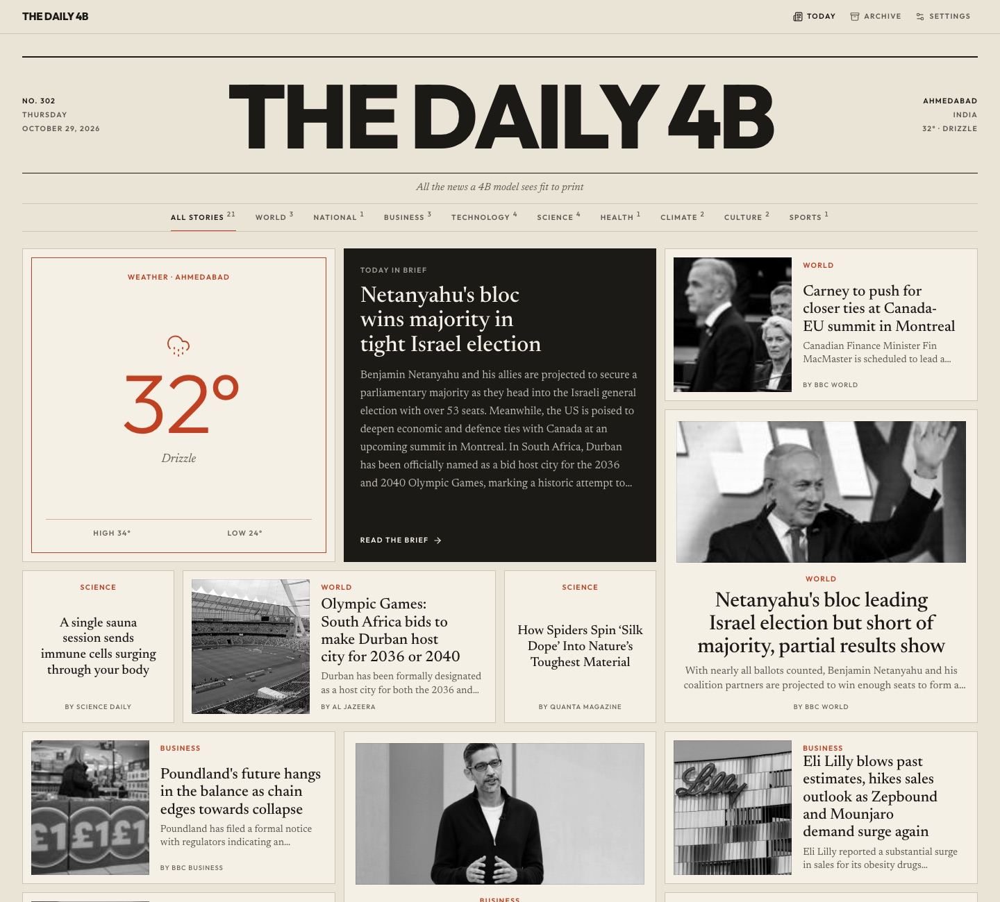
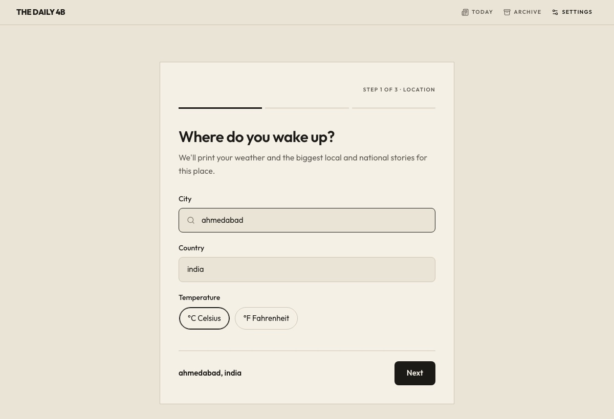

# The Daily 4B

*All the news a 4B model sees fit to print.*

A self-hosted morning newspaper. Before you wake up, it reads the tech blogs, AI labs, science journals and the biggest news from your city and country, has a small language model keep only what matters, and prints it as a newsprint-style bento page you can read over coffee.



- **Runs on a 4B model.** Curation works well on a small local model through [Ollama](https://ollama.com). No GPU? Bring a key for OpenAI, OpenRouter, Groq or any OpenAI-compatible API.
- **Read it without clicking through.** Every story gets a 60–90 word summary, and the front page opens with a short brief of the whole day.
- **Your morning, your sources.** Pick from the built-in feeds or add any RSS feed, plus Google News for your city and country.
- **Nothing runs all day.** Run it once each morning (cron, launchd, Task Scheduler or by hand). The site just reads the JSON it leaves behind.
- **Keeps an archive.** Yesterday's paper moves to the archive, and stories that already ran in the last three issues are skipped.

## Quickstart

You need Python 3.12+, Node 20.19+ and [Ollama](https://ollama.com) (or an API key, see below). Clone the repo, then from its folder:

```bash
make setup                # python venv, dependencies, web dependencies
ollama pull qwen3.5:4b    # any ~4B instruct model works
make dev                  # open http://localhost:5173 and finish the setup
make run                  # print today's paper
```

The first time you open the site it walks you through a short setup (your city, the model, your sources) and saves `config.yaml`. You can reopen it any time from **Settings**.



<details>
<summary>Without make</summary>

```bash
python3 -m venv .venv && source .venv/bin/activate
pip install -r requirements.txt
cd web && npm install && npm run dev     # setup at http://localhost:5173
python3 main.py --now                    # from the repo root, in another terminal
```

Prefer editing by hand? Copy `config.example.yaml` to `config.yaml` instead of using the setup screen.

</details>

## Use a hosted model instead

In **Settings → Who edits your paper?**, choose **With an API key**, pick a provider, and enter the model ID and key. Or set it by hand:

```yaml
# config.yaml
provider: openai
api_base_url: https://openrouter.ai/api/v1
api_model: your-provider/model-id
```

```bash
# .env (git-ignored)
DAILY4B_API_KEY=sk-...
```

The key only ever lives in `.env` or your environment, never in `config.yaml`. LM Studio and other local servers don't need one.

## Print it every morning

`python3 main.py --now` prints one issue and exits. Schedule it however you like. Use absolute paths, since the scheduler won't start in this folder.

**macOS (launchd)**: save as `~/Library/LaunchAgents/com.daily4b.press.plist`, then run `launchctl load` on it. If your Mac is asleep at 6:00, it runs when it wakes.

```xml
<?xml version="1.0" encoding="UTF-8"?>
<!DOCTYPE plist PUBLIC "-//Apple//DTD PLIST 1.0//EN" "http://www.apple.com/DTDs/PropertyList-1.0.dtd">
<plist version="1.0">
<dict>
  <key>Label</key><string>com.daily4b.press</string>
  <key>ProgramArguments</key>
  <array>
    <string>/path/to/repo/.venv/bin/python</string>
    <string>/path/to/repo/main.py</string>
    <string>--now</string>
  </array>
  <key>StartCalendarInterval</key>
  <dict><key>Hour</key><integer>6</integer><key>Minute</key><integer>0</integer></dict>
  <key>StandardOutPath</key><string>/tmp/daily4b.log</string>
  <key>StandardErrorPath</key><string>/tmp/daily4b.log</string>
</dict>
</plist>
```

**Linux (cron)**: `crontab -e`, then:

```
0 6 * * * /path/to/repo/.venv/bin/python /path/to/repo/main.py --now >> /tmp/daily4b.log 2>&1
```

**Windows (Task Scheduler)**:

```
schtasks /create /tn "Daily 4B" /sc daily /st 06:00 /tr "C:\path\to\repo\.venv\Scripts\python.exe C:\path\to\repo\main.py --now"
```

**No scheduler?** `python3 main.py --daily 06:00` stays running and prints every day at that time.

## Self-hosting

`make serve` builds the site and serves it on port 4173. Issues are read live from `data/`, so you don't need to rebuild after each morning's run. To reach it from other devices, run `npm run preview -- --host` in `web/`. If you serve it under a domain name, list it in `DAILY4B_ALLOWED_HOSTS=paper.example.com`.

**Docker**: create a `config.yaml` first (copy the example or use the setup screen locally), then:

```bash
TZ=Asia/Kolkata PRESS_TIME=06:00 docker compose up -d
```

This runs the site on port 4173 and a `press` container that prints daily at `PRESS_TIME`. It reaches Ollama on the host through `host.docker.internal`; set `DAILY4B_OLLAMA_HOST` to use another machine. For a hosted model, put `DAILY4B_API_KEY` in `.env`.

Settings can only be changed from the machine running the server. On a server or in Docker, edit `config.yaml` directly.

## Configuration

| Key | Default | |
| --- | --- | --- |
| `city`, `country` | | Your weather plus local and national news |
| `units` | `celsius` | or `fahrenheit` |
| `provider` | `ollama` | or `openai` for any OpenAI-compatible API |
| `ollama_host`, `ollama_model` | `http://localhost:11434`, `qwen3.5:4b` | |
| `api_base_url`, `api_model` | `https://api.openai.com/v1`, none | Used when `provider: openai` |
| `max_articles` | `18` | Stories per issue (6–30) |
| `tech_feeds`, `science_feeds` | see `config.example.yaml` | Lists of `{name, url}` |

| Environment variable | |
| --- | --- |
| `DAILY4B_API_KEY` | Key for the hosted model, also read from `.env` |
| `DAILY4B_OLLAMA_HOST` | Overrides `ollama_host` |
| `DAILY4B_ALLOWED_HOSTS` | Extra hostnames the preview server accepts, comma separated |

| Command | |
| --- | --- |
| `python3 main.py --now` | Print today's issue |
| `python3 main.py --dry-run` | Check config, weather and feeds without the model |
| `python3 main.py --daily 06:00` | Stay running and print every day at 06:00 |
| `--config path/to/config.yaml` | Use a different config |

## How it works

1. **Research.** `src/research.py` fetches every feed in parallel, plus Google News for your city and country, and drops anything that ran in the last three issues.
2. **Curate.** `src/curate.py` hands the numbered pool to the model, which returns the indexes it picked, a summary and an importance for each, a front-page headline and the daily brief. Titles, links and images come from the feeds, never from the model, so it can't invent them.
3. **Photos.** `src/images.py` fills in missing images from each story's preview image.
4. **Print.** `src/build.py` writes `data/latest.json` and moves the previous day's issue to `data/archive/`.
5. **Read.** The React site in `web/` lays the issue out as a bento grid, sizing each story by importance.

## Troubleshooting

- **"couldn't reach ollama"**: start it with `ollama serve`, or check `ollama_host`.
- **"ollama doesn't have …"**: `ollama pull <model>`.
- **"broken JSON twice"**: very small models sometimes struggle. Try a slightly larger model or fewer `max_articles`.
- **"skipped <feed>"**: that feed was down or blocked the request. The rest of the paper still prints.
- **Settings say they can only be changed on this machine**: open the site on the computer running `npm run dev`, or edit `config.yaml`.
- **Blocked request on a custom domain**: add it to `DAILY4B_ALLOWED_HOSTS`.

## Contributing

See [CONTRIBUTING.md](CONTRIBUTING.md). The design rules live in `.claude/skills/taste/`, built with [build-taste](https://github.com/anishfn/build-taste) by Anish. Interface reviews use the [better-* skills](https://github.com/jakubkrehel/skills) by Jakub Krehel.

## License

[MIT](LICENSE). The bundled skills in `.claude/skills/` keep their own MIT licenses.
